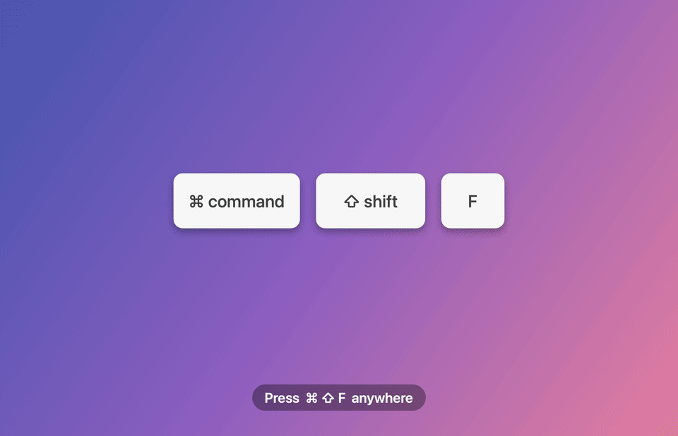

# GemmaFind

**Spotlight on steroids for macOS.** Press **⌘⇧F**, describe what you're looking for in plain language, and GemmaFind finds it by *meaning* in your documents, code, PDFs, photos, videos and voice memos. It runs entirely on your Mac with **EmbeddingGemma 2** on **LiteRT-LM**, accelerated by the Metal GPU.

🌐 **Website:** [gemmafind-app.web.app](https://gemmafind-app.web.app)



- "the lease clause about breaking early" → `lease-agreement.docx`, with the exact sentence highlighted
- "dog playing in the garden" → `weekend.mp4` at 0:00, matched on the narration
- "pizza" → `IMG_0420.jpg`, plus the moment at 0:21 in `weekend.mp4`
- "birthday cake errands" → `voice-memo-1.m4a`, matched on the spoken audio

## Features

- **One shortcut, everywhere:** ⌘⇧F opens a floating, frosted search panel on whichever screen your pointer is on.
- **Multimodal semantic search.** Text, images, video frames and audio are embedded into one 768-d space, so a text query can find a photo or a spoken sentence.
- **Hybrid ranking:**
  - cosine similarity, calibrated per modality so photos and documents compete fairly;
  - an FTS5 keyword and file-name boost, so exact words and names still win.
- **Previews that explain the match:**
  - **Text, code, docs:** the full document scrolls to the matched passage. The *best-matching sentences* (re-embedded on the fly) are highlighted in yellow and your literal query words are underlined.
  - **PDF:** opens on the right page, with the same highlights.
  - **Video and audio:** a player cued to the matching moment, with clickable "matching moments" chips.
  - **Images:** a full-size preview.
- **Live index:**
  - incremental (by modification time and size) and resumable;
  - FSEvents keeps it up to date as files change;
  - skips `node_modules`, `.git`, app bundles and the like.
- **Keyboard first:**

  | Key | Action |
  | --- | --- |
  | ↑ / ↓ | Select |
  | ↩ | Open |
  | ⌘↩ | Reveal in Finder |
  | ⌘Y | Quick Look |
  | ⌘⇧C | Copy path |
  | ⌘, | Settings |
  | Esc | Close |

- **Private:** nothing leaves your Mac. The model (485 MB) is downloaded once from Hugging Face.

## What gets indexed

Defaults: `~/Documents`, `~/Desktop`, `~/Downloads`. You can change the folders, toggle content types and add exclusion globs in **Settings**.

| Kind | Extensions | How it's embedded |
| --- | --- | --- |
| Text & code | md, txt, swift, py, ts, json, … (~90 types) | ~1,000-char sentence-aligned chunks (`title: <file> \| text: …`) |
| PDF | pdf | Per-page chunks (PDFKit) |
| Documents | docx, doc, rtf, odt, html, webarchive | Text extracted natively, then chunked |
| Images | jpg, png, heic, webp, gif, tiff | Downsampled to 896 px, vision encoder |
| Video | mp4, mov, m4v, … | One frame every ≥10 s (max 30) **and** the audio track in 20 s segments |
| Audio | m4a, mp3, wav, aiff, flac, … | 20 s segments (max 30), near-silent ones skipped, audio encoder |

## Build & run

Requires macOS 14+ on Apple Silicon and Xcode 16+ (or the Command Line Tools).

```bash
./build_app.sh
open GemmaFind.app
```

On first launch GemmaFind downloads `litert-community/embeddinggemma-2-740m-litert-lm` to `~/Library/Application Support/GemmaFind/models/`. It then starts indexing in the background; progress is shown in the menu bar and in the panel footer. macOS asks once for access to Documents, Desktop and Downloads.

To keep it, copy `GemmaFind.app` to `/Applications` and enable **Launch at login** in Settings.

> **About ⌘⇧F:** GemmaFind registers ⌘⇧F as a global shortcut, so it takes precedence over apps that use the same combination (e.g. *Find in Files* in VS Code and other editors). If another app or a macOS system shortcut already owns ⌘⇧F, GemmaFind tells you on launch and stays available from the menu bar icon.

## Development

```bash
swift test                                   # unit tests (chunker, vector index, highlighter, extraction, pipeline)
scripts/make_fixtures.sh                     # generate a mixed-media test corpus in Tests/Fixtures/corpus
scripts/record_demo.sh                       # re-record assets/demo.gif from the real app (scripted, offscreen)
swift run gemmafind-cli smoke                # load the model on GPU; sanity-check text/image/audio embeddings
swift run gemmafind-cli index Tests/Fixtures/corpus --db /tmp/t.sqlite
swift run gemmafind-cli search "solar panels in snow" --db /tmp/t.sqlite
```

**Test mode for the app.** This indexes only one folder into a separate database and does not save settings:

```bash
GEMMAFIND_TEST_FOLDER=/path/to/folder GEMMAFIND_DEMO_QUERY="pizza||cache eviction" \
GEMMAFIND_SNAPSHOT_DIR=/tmp GemmaFind.app/Contents/MacOS/GemmaFind
```

### Layout

```
Sources/GemmaFindCore/   # UI-free engine
  Embedder.swift         # EmbeddingGemma 2 on LiteRT-LM (GPU → CPU fallback), prompt formats
  Indexer.swift          # crawl, change detection, extraction, batched embedding
  IndexStore.swift       # SQLite: files, chunks + embedding BLOBs, FTS5
  VectorIndex.swift      # in-memory matrix, vDSP scoring, per-modality calibration
  SearchEngine.swift     # hybrid fusion + per-file grouping
  Highlighter.swift      # query-term + best-sentence highlighting
  TextExtractor.swift, MediaProcessor.swift, TextChunker.swift, FolderWatcher.swift
Sources/GemmaFind/       # AppKit/SwiftUI menu-bar app (panel, previews, settings)
Sources/gemmafind-cli/   # developer CLI
website/                 # homepage (Firebase Hosting); data/demo.json = real search results via `gemmafind-cli demo-json`
Vendor/LiteRTLM/         # LiteRT-LM v0.18.0 Swift wrapper (Apache 2.0, verbatim)
```

The LiteRT-LM runtime comes from the official prebuilt `CLiteRTLM_mac.xcframework` (v0.18.0, checksum-pinned in `Package.swift`). The Swift wrapper is vendored instead of depending on the git repo, whose history is several GB.
